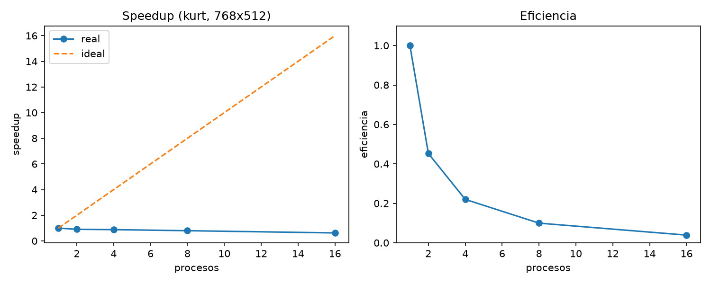
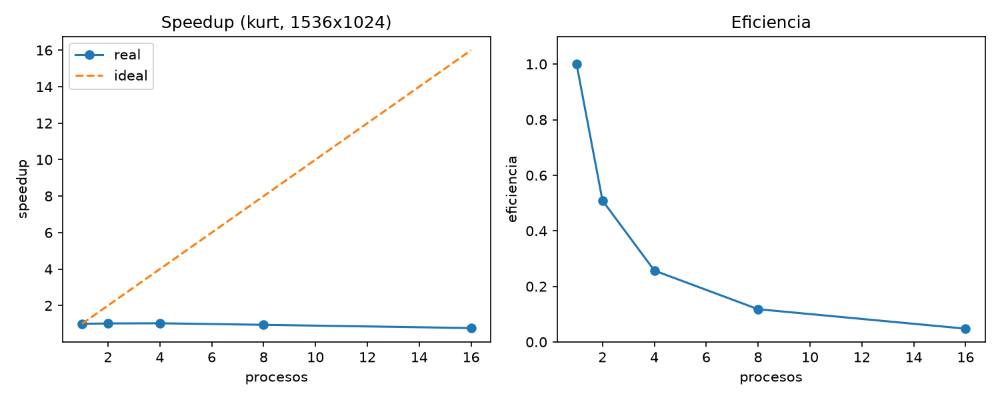
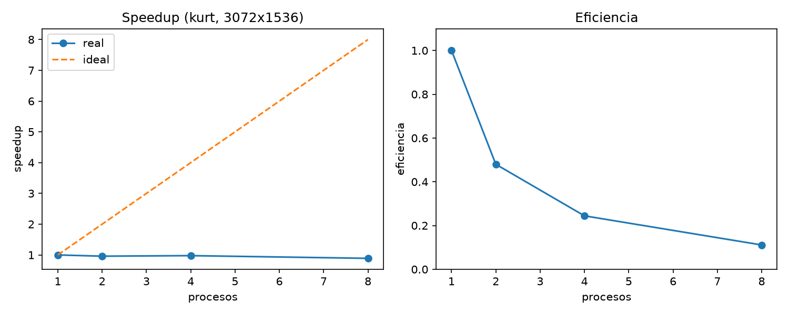
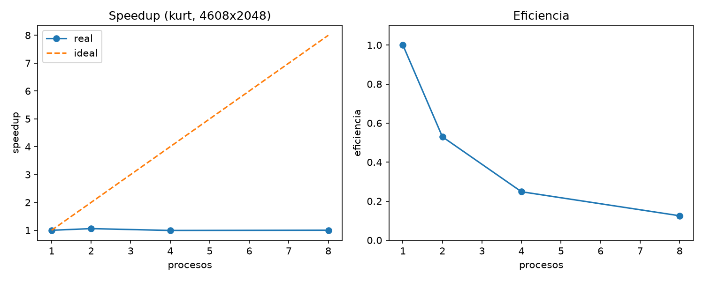

# Resultados de rendimiento (máquina de Kurt)

## Protocolo de medición

Las pruebas de escalabilidad se ejecutaron con `src/experiments.py` sobre cuatro mosaicos construidos a partir del conjunto Kodak (`src/build_mosaic.py`), fijando $k = 20$ componentes principales por canal RGB en `float64` y limitando BLAS a 1 hilo por proceso. Para cada configuración de procesos $p$ se midió por separado el tiempo de arranque del `Pool`, se ejecutó una compresión de calentamiento no contabilizada y se reportó la mediana del tiempo de ejecución de `pca.comprimir(X, k)` sobre las repeticiones configuradas (`--reps 3` en `1x1` y `2x2`; `--reps 2` en `4x3`; `--reps 1` en `6x4`).

El *speedup* y la eficiencia se calcularon como:

$$S(p) = \frac{T(1)}{T(p)}, \qquad E(p) = \frac{S(p)}{p}$$

En todas las corridas exitosas la diferencia máxima frente a la reconstrucción secuencial (`dif_max_vs_p1`) fue `0.00e+00`.

## Mosaico `1x1` (768 × 512 px, 3 repeticiones)

| Procesos ($p$) | Arranque Pool (s) | Tiempo mediana (s) | Speedup | Eficiencia | Dif. máx. vs $p=1$ |
|---:|---:|---:|---:|---:|---:|
| 1 | 0.000 | 0.6412 | 1.000 | 1.000 | `0.00e+00` |
| 2 | 1.881 | 0.7082 | 0.905 | 0.453 | `0.00e+00` |
| 4 | 1.956 | 0.7290 | 0.880 | 0.220 | `0.00e+00` |
| 8 | 2.069 | 0.8051 | 0.796 | 0.100 | `0.00e+00` |
| 16 | 2.718 | 1.0290 | 0.623 | 0.039 | `0.00e+00` |

## Mosaico `2x2` (1536 × 1024 px, 3 repeticiones)

| Procesos ($p$) | Arranque Pool (s) | Tiempo mediana (s) | Speedup | Eficiencia | Dif. máx. vs $p=1$ |
|---:|---:|---:|---:|---:|---:|
| 1 | 0.000 | 4.2352 | 1.000 | 1.000 | `0.00e+00` |
| 2 | 1.860 | 4.1617 | 1.018 | 0.509 | `0.00e+00` |
| 4 | 1.985 | 4.1210 | 1.028 | 0.257 | `0.00e+00` |
| 8 | 2.108 | 4.4923 | 0.943 | 0.118 | `0.00e+00` |
| 16 | 2.528 | 5.5361 | 0.765 | 0.048 | `0.00e+00` |

## Mosaico `4x3` (3072 × 1536 px, 2 repeticiones)

| Procesos ($p$) | Arranque Pool (s) | Tiempo mediana (s) | Speedup | Eficiencia | Dif. máx. vs $p=1$ |
|---:|---:|---:|---:|---:|---:|
| 1 | 0.000 | 26.9274 | 1.000 | 1.000 | `0.00e+00` |
| 2 | 1.862 | 28.0569 | 0.960 | 0.480 | `0.00e+00` |
| 4 | 1.994 | 27.5553 | 0.977 | 0.244 | `0.00e+00` |
| 8 | 2.110 | 30.2743 | 0.889 | 0.111 | `0.00e+00` |

> **Nota sobre $p=16$ en `4x3`:** al intentar ejecutar con 16 procesos, Windows interrumpió la transferencia de resultados con `MaybeEncodingError` / `OSError(22, 1450)` (*recursos insuficientes en el sistema*), debido al envío simultáneo de 16 matrices parciales de $3072 \times 3072$ en `float64` (~72 MiB cada una, ~1.13 GiB acumulados por canal a través de *pipes*). Por ello la tabla reporta únicamente hasta $p=8$.

## Mosaico `6x4` (4608 × 2048 px, 1 repetición)

| Procesos ($p$) | Arranque Pool (s) | Tiempo mediana (s) | Speedup | Eficiencia | Dif. máx. vs $p=1$ |
|---:|---:|---:|---:|---:|---:|
| 1 | 0.000 | 89.6498 | 1.000 | 1.000 | `0.00e+00` |
| 2 | 1.874 | 84.6063 | 1.060 | 0.530 | `0.00e+00` |
| 4 | 1.924 | 90.2362 | 0.994 | 0.248 | `0.00e+00` |
| 8 | 2.217 | 89.4271 | 1.002 | 0.125 | `0.00e+00` |

> **Nota sobre $p=16$ en `6x4`:** al igual que en `4x3`, la corrida con 16 procesos falló con `OSError 1450` al serializar y retornar 16 matrices parciales de $4608 \times 4608$ en `float64` (~162 MiB cada una, ~2.53 GiB acumulados por canal).

## Observaciones principales

- **Imagen individual (`1x1`):** el tiempo secuencial es muy breve (0.6412 s) y el *speedup* se mantiene por debajo de 1 en todos los casos (de 0.905 con $p=2$ hasta 0.623 con $p=16$).
- **Mosaicos grandes (`2x2`, `4x3`, `6x4`):** el tiempo de cómputo crece de 4.24 s hasta 89.65 s en $p=1$. Se registran ligeras aceleraciones en `2x2` (máximo 1.028× con $p=4$) y en `6x4` (máximo 1.060× con $p=2$, reduciendo el tiempo de 89.65 s a 84.61 s), mientras que en `4x3` el *speedup* se mantiene ligeramente por debajo de 1 (0.977× en $p=4$).
- **Eficiencia:** decrece de manera constante al aumentar $p$, cayendo de ~0.45–0.53 en $p=2$ a ~0.10–0.13 en $p=8$ y por debajo de 0.05 en $p=16$.
- **Arranque del `Pool`:** crece de manera consistente con el número de procesos (~1.86–1.88 s en $p=2$, ~1.92–1.99 s en $p=4$, ~2.07–2.22 s en $p=8$ y ~2.53–2.72 s en $p=16$), superando incluso al propio tiempo de cálculo en `1x1`.